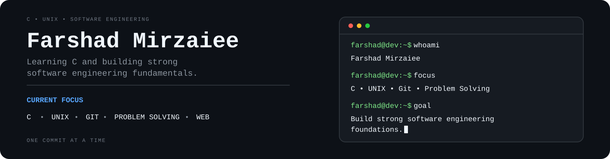

  

# Farshad Mirzaiee

`software engineering student` · `42 Tirana` · `C / UNIX / computer science`

I'm studying software engineering at **42 Tirana**, with a focus on building strong foundations in C, computer science, and the design of reliable software.

I enjoy understanding how things work beneath the surface; from memory and processes to operating systems and larger software systems.

### 01 / current focus

- **C programming** — working through *C Programming: A Modern Approach* by K. N. King
- **Computer science** — algorithms, problem-solving, and mathematical foundations
- **UNIX / Linux** — shell, processes, files, and development tools
- **42 Common Core** — preparing for the next stage of the curriculum

### 02 / selected work

**[C Programming: A Modern Approach](https://github.com/farshad-mirzaiee/c-programming-a-modern-approach)**  
Exercises and programming projects from K. N. King's textbook, documenting my progress in C.

**[The Odin Project](https://github.com/farshad-mirzaiee/the-odin-project)**  
Web development exercises and projects completed while learning front-end fundamentals.

### 03 / tools & technologies

<table>
  <tr>
    <th align="left">Systems</th>
    <th align="left">Web</th>
    <th align="left">Tools</th>
  </tr>
  <tr>
    <td>
      
      
      
    </td>
    <td>
      
      
      
    </td>
    <td>
      
      
      
    </td>
  </tr>
</table>

### 04 / long-term interests

`operating systems` · `systems programming` · `software architecture` · `AI & quantitative research`

---

Learning in public. Building with care.
